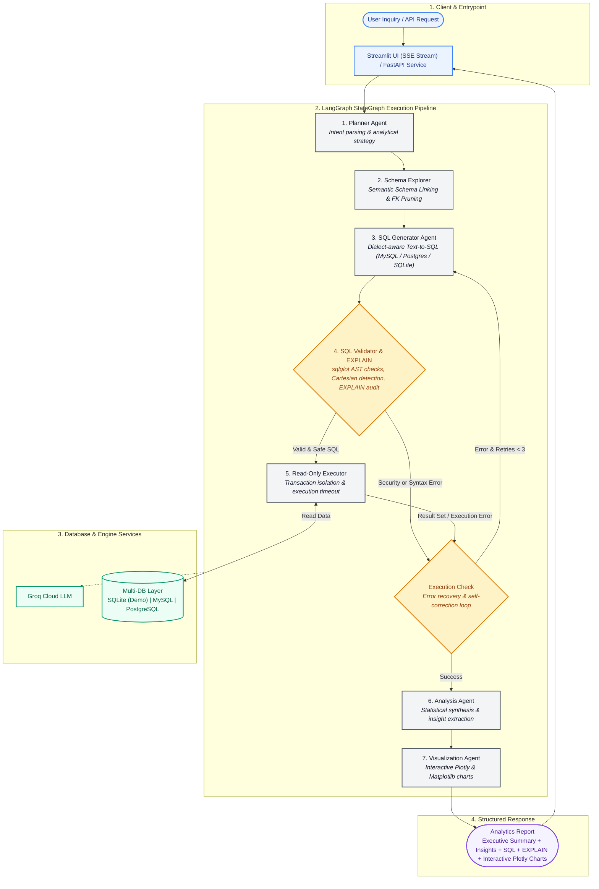
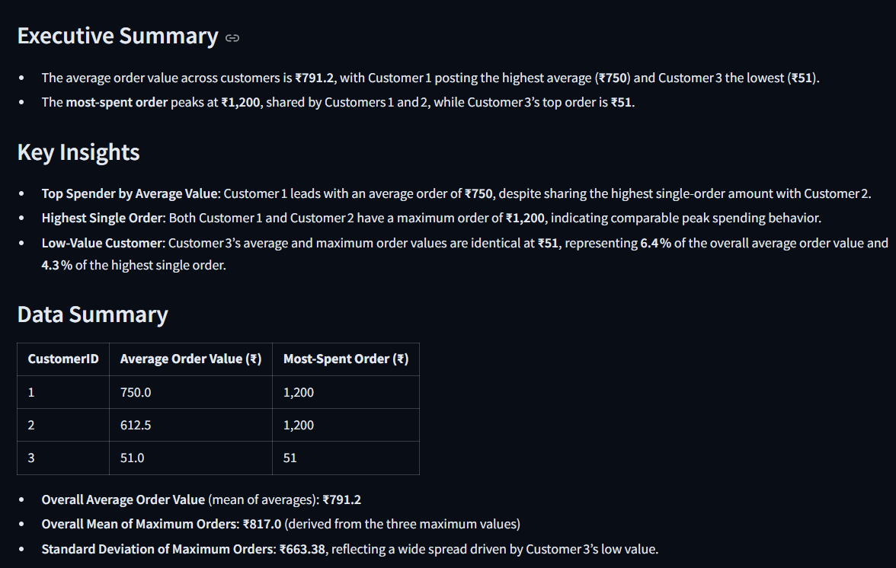
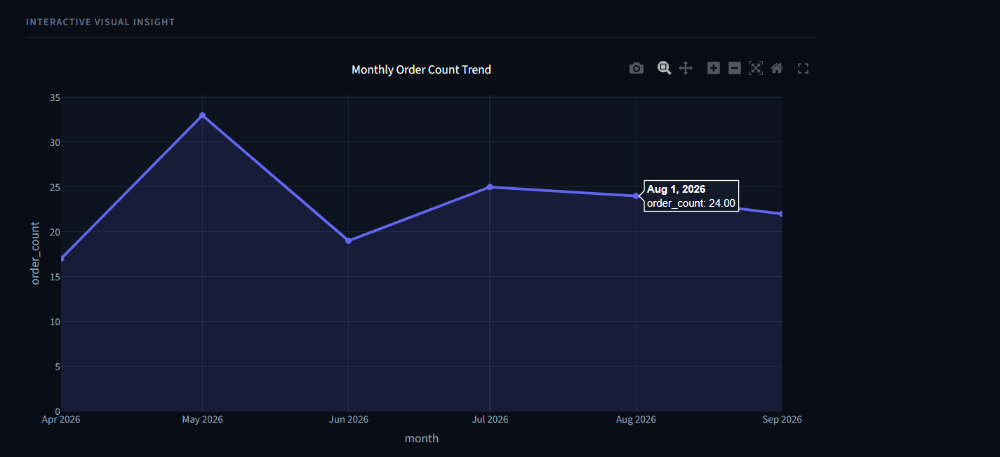
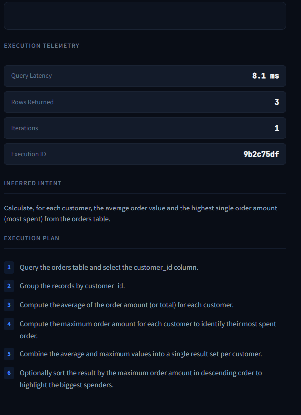
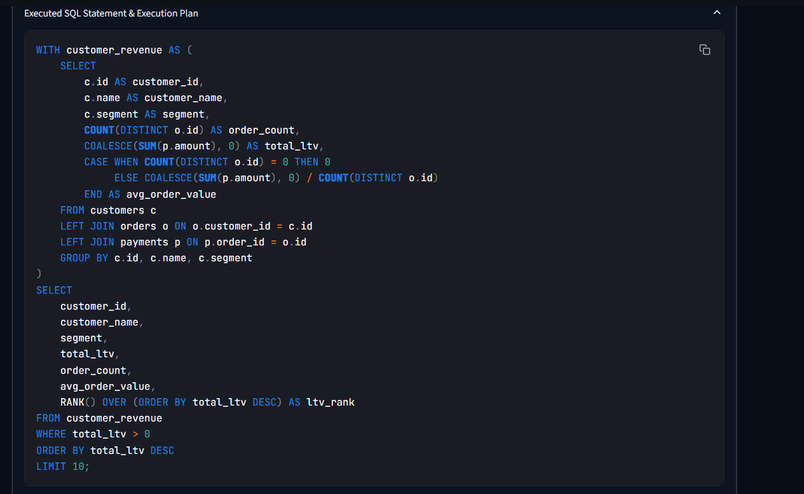

# Agentic Data Analyst

A production-grade, dialect-agnostic agentic data analysis system powered by **LangGraph**, **Groq Cloud LLM**, **sqlglot**, and **Plotly**. It decomposes complex natural language inquiries into structured analytical plans, semantically links schemas, verifies AST-level security and performance (`EXPLAIN` plan & Cartesian audit), and generates interactive executive-level reports.

---

## Key Features

- **Zero-Setup Demo Mode**: Built-in SQLite database with 140 orders, 28 products, and 30 customers ready to test in 5 seconds with zero external database configuration. Also supports production **MySQL** and **PostgreSQL**.
- **Semantic Schema Linking & Pruning**: Intelligently scores and links only relevant tables and foreign key bridges, scaling up to 500+ database tables without overflowing prompt context windows.
- **Dialect-Aware SQL Generation**: Generates native dialect SQL (MySQL 8.0+, PostgreSQL, SQLite) with automated query performance auditing and AST Cartesian join checks.
- **Agentic Self-Correction with Query `EXPLAIN`**: Catches execution errors, destructive SQL, and inefficient plans, driving iterative self-correction loops.
- **Dynamic Interactive Visualizations**: Generates rich **Plotly** figures with hover tooltips, zoom/pan controls, and PNG exports.
- **Real-Time Streaming Agent Traces**: Delivers real-time agent thoughts and node status updates in both the Streamlit UI (`st.status`) and FastAPI via Server-Sent Events (`/analyze/stream`).

---

## Architecture



---

## Application Previews

The following previews demonstrate the multi-agent workflow, real-time telemetry, interactive Plotly visualizations, and dialect-aware SQL execution:

### 1. Executive Summary & Analytical Report


### 2. Interactive Visual Insights 


### 3. Execution Telemetry, Inferred Intent & Analytical Plan


### 4. Dialect Aware SQL Generation & Execution Plan


---

## Local Setup

### Prerequisites

- **Python 3.11+**
- **Groq API key** (free at [console.groq.com](https://console.groq.com))
- *(Optional)* A running MySQL or PostgreSQL instance — or use the built-in **Zero-Setup Demo SQLite mode** with zero configuration required.

### Install

```bash
git clone https://github.com/your-username/agentic-data-analyst.git
cd agentic-data-analyst
python -m venv .venv
.venv\Scripts\activate        # Windows (or source .venv/bin/activate on Linux/macOS)
pip install -r requirements.txt
```

### Run Streamlit UI

```bash
streamlit run streamlit_app.py
```

Open `http://localhost:8501`, enter your Groq API key, click **Connect Demo Database** (Zero-Setup SQLite mode), and start analyzing immediately!

### Multi-Database Support & Seeding

1. **Zero-Setup Demo SQLite DB**: Automatically initializes and seeds `data/demo_ecommerce.db` on first run.
2. **External MySQL / PostgreSQL**: Configure host, port, user, password, and database in the sidebar or via API.
3. **Seed MySQL/Postgres via CLI**:
   ```bash
   python app/db/seed_demo.py --host localhost --user root --password your_password --database your_db
   ```

### Run FastAPI

```bash
uvicorn main:app --reload --port 8000
```

Interactive API documentation available at `http://localhost:8000/docs`.

---

## API Endpoints

| Method | Path | Description |
|---|---|---|
| POST | `/analyze` | Run full agent workflow and return structured report + Plotly figure spec |
| POST | `/analyze/stream` | Stream real-time agent execution traces via Server-Sent Events (SSE) |
| GET | `/health` | Service health status |
| GET | `/runs/{run_id}` | Fetch historical run telemetry |

**POST /analyze request (Demo SQLite Mode):**
```json
{
  "question": "Which product categories generated the most revenue?",
  "groq_api_key": "gsk_...",
  "use_demo_db": true
}
```

**POST /analyze request (External MySQL / PostgreSQL):**
```json
{
  "question": "Which product categories generated the most revenue last quarter?",
  "groq_api_key": "gsk_...",
  "dialect": "mysql",
  "mysql_host": "localhost",
  "mysql_port": 3306,
  "mysql_user": "readonly_user",
  "mysql_password": "...",
  "mysql_database": "mydb"
}
```

---

## Evaluation

```bash
python evaluation/evaluate.py \
  --host localhost \
  --user readonly_user \
  --password secret \
  --database mydb \
  --groq-key gsk_...
```

Results are saved to `evaluation/results/eval_<timestamp>.json`.

---

## Tests

```bash
pytest tests/ -v
```

---

## Security & Safety Guardrails

- **Zero Hardcoded Secrets**: All credentials passed via environment variables or UI session memory.
- **Enforced Read-Only Isolation**: Database connections enforced read-only at session/connection level (MySQL `READ ONLY` session transaction; SQLite foreign key PRAGMA and write-blocking).
- **Deterministic AST Validation**: SQL parsed via `sqlglot` to block destructive keywords (`DROP`, `DELETE`, `UPDATE`, `ALTER`, `TRUNCATE`, `GRANT`).
- **CTE & Subquery Virtual Table Resolution**: Accurately recognizes Common Table Expressions (`WITH ... AS (...)`) to prevent false-positive schema rejections.
- **Pre-Execution Performance Auditing**: Runs `EXPLAIN QUERY PLAN` and flags unconstrained Cartesian joins before executing on the database.
- **Hard Execution Boundaries**: 30-second query timeout and 10,000-row circuit breaker.

---

## Technical Notes

- **Multi-Dialect Compatibility**: Natively formats date/time, window functions, and string aggregations across MySQL 8.0+, PostgreSQL, and SQLite.
- **Evaluation Suite**: 50 analytical benchmark questions covering simple aggregations, multi-table joins, CTEs, and window functions (`evaluation/evaluate.py`).

---

## Evaluation Results

> Run `python evaluation/evaluate.py` against your database and fill in actual numbers here.

```
Total questions:       50
SQL execution success: [run to measure]%
Schema adherence:      [run to measure]%
Avg answer fact score: [run to measure]%
Avg SQL retries:       [run to measure]
Avg latency:           [run to measure] ms
```
