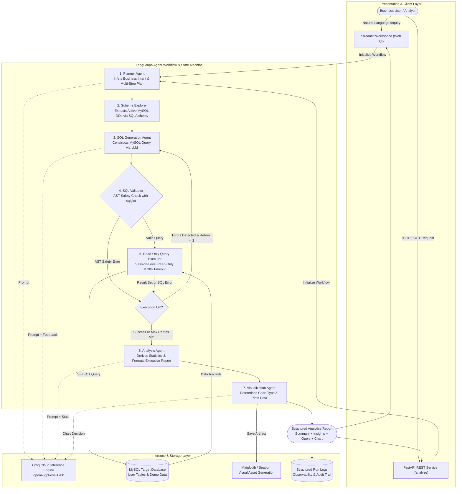

# Agentic Data Analyst

A production-style agentic analytics system that converts natural-language business questions into validated MySQL queries, executes them through a read-only database layer, and returns evidence-backed insights and visualizations.

## Architecture



## Application Previews

The following screenshots demonstrate the workspace, natural language query workflow, and analytical report outputs:

| Workspace & Analytical Report | Telemetry & Execution Flow |
|:---:|:---:|
|  |  |
| **Interactive Query & Visualizations** | **Database Connection & Schema Introspection** |
|  |  |

## Local Setup

### Prerequisites

- Python 3.11+
- A running MySQL instance (any version)
- A Groq API key (free at [console.groq.com](https://console.groq.com))

### Install

```bash
cd agentic-data-analyst
python -m venv .venv
.venv\Scripts\activate        # Windows
pip install -r requirements.txt
```

### Run Streamlit UI

```bash
streamlit run streamlit_app.py
```

Open `http://localhost:8501`, enter your Groq API key and MySQL credentials in the sidebar, and start asking questions.

### Seed Demo Dataset

You can populate a comprehensive demo e-commerce dataset (`customers`, `products`, `categories`, `orders`, `order_items`, `payments`) in three ways:

1. **Via Streamlit UI**: Connect your database in the sidebar and click **Load Sample Dataset**.
2. **Via Python CLI**:
   ```bash
   python app/db/seed_demo.py --host localhost --user root --password your_password --database your_db
   ```
3. **Via SQL file**: Import [`sample_dataset.sql`](file:///c:/Users/Ujjwal%20Bajpayee/Desktop/Agentic%20Data%20Analyst/agentic-data-analyst/sample_dataset.sql) using MySQL CLI or your preferred GUI client:
   ```bash
   mysql -u root -p your_db < sample_dataset.sql
   ```

### Run FastAPI

```bash
uvicorn main:app --reload --port 8000
```

API docs at `http://localhost:8000/docs`.

## Docker

```bash
cp .env.example .env
# Edit .env with your credentials
docker-compose up --build
```

- Streamlit: `http://localhost:8501`
- FastAPI: `http://localhost:8000`

## API Endpoints

| Method | Path | Description |
|--------|------|-------------|
| POST | `/analyze` | Run full agent workflow |
| GET | `/health` | Health check |
| GET | `/runs/{run_id}` | Fetch run log |

**POST /analyze request:**
```json
{
  "question": "Which product categories generated the most revenue last quarter?",
  "groq_api_key": "gsk_...",
  "mysql_host": "localhost",
  "mysql_port": 3306,
  "mysql_user": "readonly_user",
  "mysql_password": "...",
  "mysql_database": "mydb"
}
```

## Evaluation

```bash
python evaluation/evaluate.py \
  --host localhost \
  --user readonly_user \
  --password secret \
  --database mydb \
  --groq-key gsk_...
```

Results are saved to `evaluation/results/eval_<timestamp>.json`.

## Tests

```bash
pytest tests/ -v
```

## Security

- All credentials passed via environment variables or UI — never hardcoded
- MySQL connections are enforced read-only at session level
- SQL validated for destructive keywords before execution
- Query timeout: 30s, row cap: 10,000
- Input length limit: 2,000 characters
- Error messages sanitized before returning to client

## Known Limitations

- Schema caching is in-memory per session (not cross-process persistent)
- Visualization is best-effort; complex multi-axis charts are not yet supported
- The 50-question benchmark assumes a standard e-commerce schema; actual scores depend on your database structure
- Window functions require MySQL 8.0+

## Evaluation Results

> Run `python evaluation/evaluate.py` against your database and fill in actual numbers here.

```
Total questions:       50
SQL execution success: [run to measure]%
Schema adherence:      [run to measure]%
Avg answer fact score: [run to measure]%
Avg SQL retries:       [run to measure]
Avg latency:           [run to measure] ms
```
